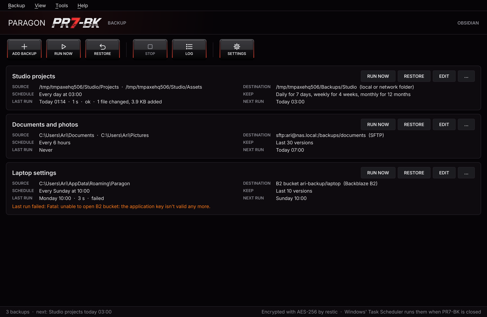
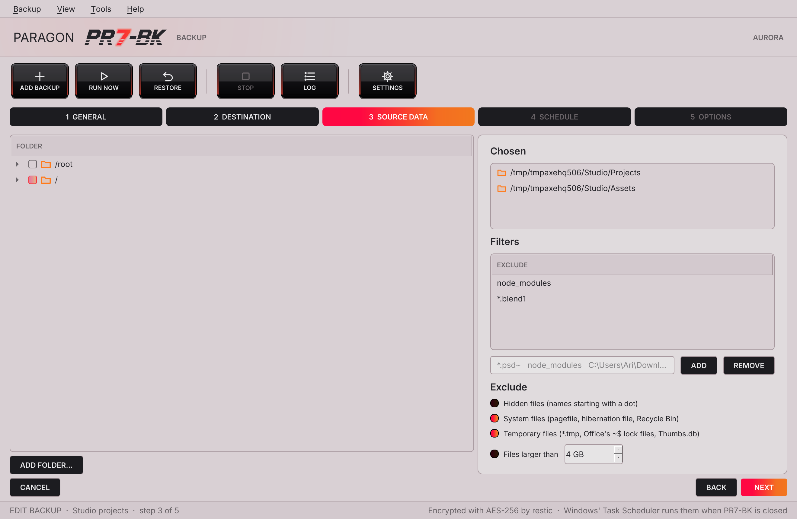
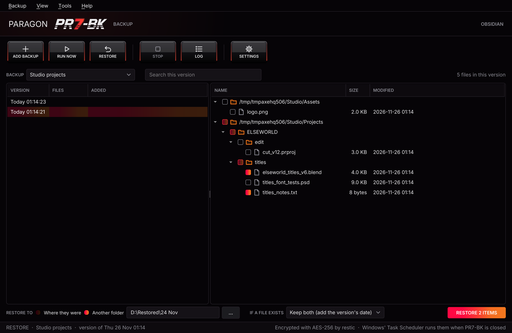

# Paragon PR7-BK

Backups, the way **Duplicati** makes them, in the Paragon family look (PR7-Z ... PR7-LN, PR7-HW). Python and PySide6.
The backing up itself is done by the official **restic** program, shipped unmodified inside PR7-BK (the way PR7-Z
uses 7-Zip): PR7-BK has no backup code of its own.

## What it does

- **Your backups:** each card shows what's backed up, where to, the schedule, what's kept, how the last run went and
  the next run. Run now, Stop, Restore, Edit, Log, Verify, Copy, Delete.
- **Add backup** in five steps:
  1. **General:** a name and a password. restic encrypts everything with it (AES-256); without it nobody can open
     the backup, you included. It's kept in Windows' Credential Manager, never in PR7-BK's files.
  2. **Destination:** a local or network folder, an SFTP server (with your SSH key), restic's REST server, Amazon S3
     (or compatible) or Backblaze B2. Test connection says whether a backup is already there.
  3. **Source data:** folders ticked in a tree; filters (`*.tmp`, `node_modules`, a whole folder); leave out hidden,
     system or temporary files and files over a size.
  4. **Schedule:** only when you click, every N hours, daily or weekly. Windows' Task Scheduler runs it even when
     PR7-BK is closed.
  5. **Options:** keep every version, the last N, or one a day / week / month for as long as you choose; back up
     files other programs have open (Volume Shadow Copy, as administrator).
- **Only what changed:** after the first backup, only changed pieces are sent, and each piece is stored once.
- **Restore:** pick a version, tick files or folders (with search), and put them back where they were or in another
  folder. If a file is already there: keep both (the version's date is added), replace it, or skip it.

## Building

`pip install -r requirements.txt -r requirements-dev.txt`, put restic in `engine/` (CI downloads the pinned release),
`python -m pytest`, `pyinstaller pr7bk.spec`, then Inno Setup: `iscc /DAppVersion=x.y.z installer\pr7bk.iss`.
